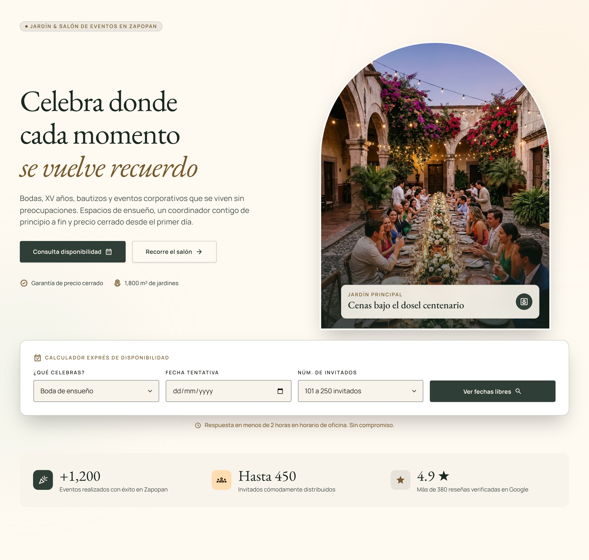
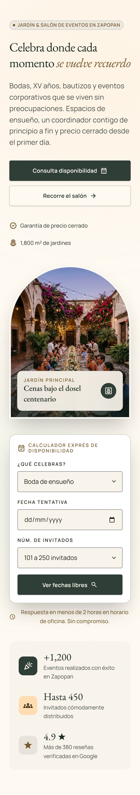
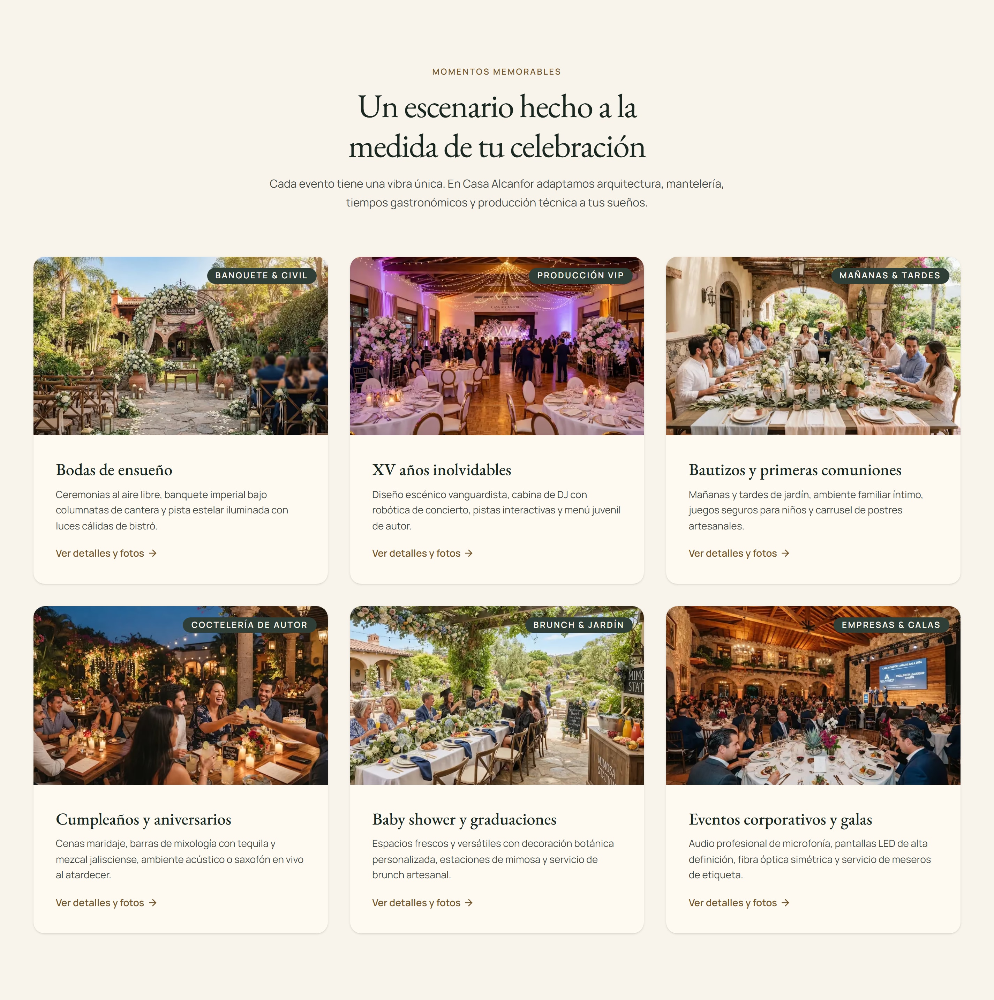
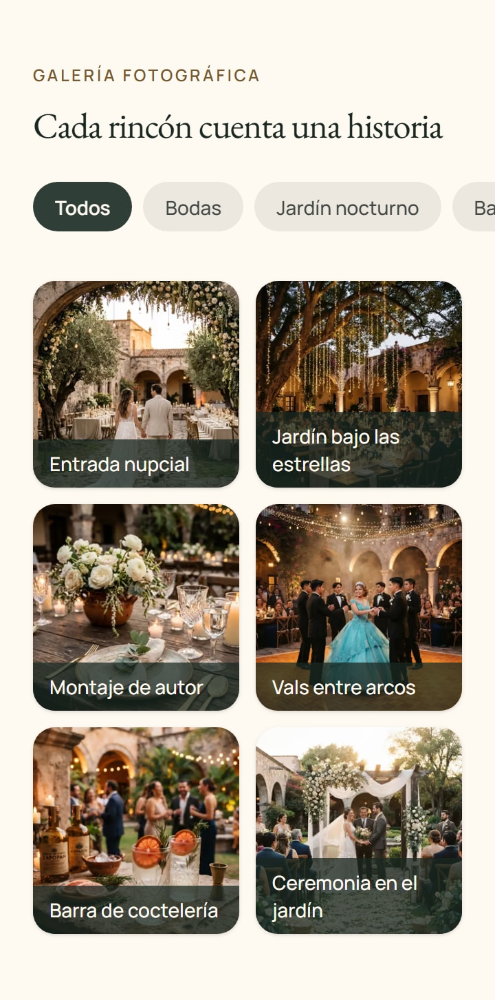

# Casa Alcanfor · Landing de un salón de eventos desde un diseño de Stitch

Caso de estudio de maquetación y accesibilidad: un diseño generado en [Stitch](https://stitch.withgoogle.com) llevado a React 19, TypeScript y Tailwind CSS v4 con Atomic Design. El salón de eventos es la excusa. Lo que se demuestra es convertir la salida de un generador en un sistema de componentes mantenible, con tokens, estados, teclado, foco y lectores de pantalla que el diseño no resolvía.

> **Proyecto conceptual.** Casa Alcanfor no existe. El negocio, los datos de contacto, las cifras («+1,200 eventos», «más de 380 reseñas») y los testimonios son ficticios, y el sitio lo dice en una franja fija arriba del header. Los teléfonos y correos usan valores reservados (`33 0000 0000`, dominio `.example`).

**Demo:** pendiente del primer despliegue en Netlify.

[](docs/cover.jpg)

Capturas del sitio en [Capturas](#capturas).

---

## Qué demuestra

- **Del generador a un sistema.** El HTML de Stitch se usó como referencia, no como código: se rehízo en 19 átomos, 15 moléculas, 21 organismos y una plantilla, con el copy en `src/content/` y sin valores arbitrarios ni hex en los componentes.
- **Tokens en 3 niveles.** Primitivos en `:root`, semánticos en `@theme inline` (`--color-surface`, `--color-text-muted`, `--color-accent`…) y de componente donde hace falta, todo en `src/styles/theme.css`. El color del foco se redefine por superficie para mantener 3:1 sobre fondos claros y oscuros.
- **Accesibilidad implementada.** Objetivo WCAG 2.2 AA: un solo `h1`, landmarks con nombre, skip link, menú en `<dialog>` modal, pestañas con flechas, Inicio y Fin, filtros con `aria-pressed` y anuncio, acordeón y formulario con resumen de errores que recibe el foco.
- **Foco que nunca queda tapado (2.4.11).** El header es sticky y su altura se mide con `ResizeObserver` para `scroll-padding-top`; lo fijo de abajo (barra móvil y botón de WhatsApp) reserva su espacio con `scroll-padding-bottom`, y se prueba con Tab y Shift+Tab en todo el recorrido.
- **Componentes que responden a su contenedor.** Las tarjetas de eventos cambian entre vertical y compacta con `@container`, no con el ancho de la pantalla. Los media queries quedan para el layout de la página.

---

## Stack tecnológico

**Estructura**

 

**Estilos**

 

**Accesibilidad y pruebas**

  

**Build y herramientas**

   

**Diseño**


**Despliegue**


**Control de versiones**

 

---

## Arquitectura

**Atomic Design completo**, con el nivel decidido por la función del componente:

- **Átomos** (`Button`, `Input`, `Heading`, `Icon`…): no importan otros componentes.
- **Moléculas** (`FormField`, `EventCard`, `AccordionItem`…): combinan átomos con una sola responsabilidad.
- **Organismos** (`SiteHeader`, `Hero`, `SpacesTabs`, `QuoteForm`…): secciones completas. Si uno necesita a otro, lo recibe por slots y se compone en la plantilla.
- **Plantilla** (`LandingTemplate`): el orden y los landmarks de la página.

**Presentacional y contenedor.** Átomos, moléculas y organismos solo reciben props y guardan estado de interfaz (abierto, pestaña activa). Las páginas son los contenedores: leen el contenido, guardan el estado compartido y lo pasan hacia abajo. La lógica reutilizable vive en hooks (`src/lib/hooks/`): medir el header, la barra móvil, el foco no tapado, las pestañas con flechas, el estado en la URL y el formulario.

**Componentes.** Props tipadas que extienden las nativas, variantes con `cva`, clases con `cn()` (clsx + tailwind-merge configurado con los tokens) y `ref` como prop de React 19.

**Rutas sin router.** `main.tsx` lee el pathname: `/` es la landing, `/design-system` el catálogo de componentes (con `noindex`) y cualquier otra ruta muestra la 404. Netlify sirve `404.html` con estado 404; la 404 dentro de `index.html` es el respaldo si un hosting manda todo a la landing.

---

## Decisiones técnicas

- **Imágenes.** Las fotos originales se guardan en WebP calidad 92 y `pnpm images` (sharp) genera variantes AVIF de 320 a 1280 px más un manifiesto tipado con `srcset`, `width` y `height`. Cada foto se recorta en origen solo donde ningún ancho entre 320 y 1440 px la muestra completa. La foto del hero se carga de inmediato (`loading="eager"`); las demás, diferidas.
- **Fuentes.** EB Garamond y Manrope desde `@fontsource`, servidas por el propio sitio. Solo se precarga Manrope 400, la fuente del texto que pinta primero en móvil. Las fuentes de respaldo llevan métricas ajustadas para que el cambio de fuente no mueva el contenido (CLS de 0), también con las fuentes de Android (Noto Serif y Roboto), que se prueban con fixtures.
- **Foco no tapado (2.4.11).** Además del `scroll-padding`, un hook vuelve a mostrar el control enfocado con teclado si algo fijo lo tapa. La barra móvil cambia de estado según la sección y su espacio reservado sigue a lo visible.
- **`@container`.** La tarjeta de eventos pasa a compacta (miniatura cuadrada y texto a todo el ancho) cuando su contenedor es angosto, con su propio recorte 1:1 de la foto.
- **`scrollbar-gutter`.** Solo en páginas con `<dialog>` (`html:has(dialog)`): al bloquear el scroll del fondo con el menú abierto, el ancho no cambia. En la 404 y en `/design-system` queda en `auto`, así que una página sin scroll no muestra un canal vacío.
- **Metadatos desde el contenido.** Un plugin de Vite genera título, descripción, Open Graph, Twitter Card y JSON-LD (`EventVenue`) desde `src/content/`, sin reseñas ni datos inventados en los datos estructurados. Lo que depende del dominio (canonical, `og:url`, `og:image`, sitemap) sale de `VITE_SITE_URL` y se omite si está vacía.
- **Netlify.** `X-Robots-Tag: noindex` en todo el sitio (es un proyecto conceptual), `nosniff`, `Referrer-Policy` y caché inmutable de un año en `/assets/*`.

---

## QA

El objetivo es **WCAG 2.2 AA**. Este README no afirma conformidad: dice qué se prueba y cómo.

- `pnpm lint`: ESLint con `jsx-a11y` en modo strict, con los átomos mapeados a su elemento nativo (`Button` → `button`, `TextLink` → `a`…).
- `pnpm typecheck` y `pnpm build`: TypeScript strict, también en las pruebas y los scripts.
- `pnpm test:e2e`: Playwright contra el build (`vite preview`) en dos proyectos, 390 y 1440 px. 180 pruebas: 162 pasan y 18 se omiten a propósito (las que solo aplican a uno de los dos anchos).
  - axe sin violaciones serious ni critical en la landing (también con errores en el formulario y con el menú abierto), en `/design-system` y en la 404.
  - Teclado real con `keyboard.press`: skip link, menú, pestañas, filtros, acordeón, calculador y formulario, con y sin errores.
  - Anclas: cada enlace deja su sección justo debajo del header (±1 px), desde arriba y con la página ya desplazada.
  - 320 px, zoom al 200 % y `prefers-reduced-motion: reduce`.
  - Foco no tapado por lo fijo con Tab y Shift+Tab en toda la página.
- Cada corrección se validó quitándola y comprobando que su prueba vuelve a fallar.

---

## Inicio rápido

Requisitos: Node 26 y pnpm 11 (la versión exacta sale de `packageManager`, con Corepack).

```bash
git clone https://github.com/Osvalam86/casa-alcanfor-stitch.git
cd casa-alcanfor-stitch
pnpm install
pnpm dev
```

Abre <http://localhost:5173>. El formulario valida y simula el envío: no hay backend y los datos no se guardan.

| Script | Qué hace |
|---|---|
| `pnpm dev` | Servidor de desarrollo de Vite en `localhost:5173` |
| `pnpm build` | Comprueba los tipos y genera `dist/` |
| `pnpm preview` | Sirve `dist/` en `localhost:4173` |
| `pnpm lint` | ESLint con `jsx-a11y` en modo strict |
| `pnpm typecheck` | `tsc -b`, incluidas las pruebas y los scripts |
| `pnpm test:e2e` | Compila y corre Playwright + axe contra el build |
| `pnpm images` | Regenera las variantes AVIF de las fotos y su manifiesto (sharp) |
| `pnpm icons` | Regenera el favicon y los íconos desde `public/icon.svg` |
| `pnpm screens` | Compila y guarda las 4 capturas del README en `docs/screens/` (360 y 1440 px, a 2×) |

`pnpm test:e2e` y `pnpm screens` usan el Chromium de Playwright (`pnpm exec playwright install chromium`). `pnpm icons` usa Edge; con `PW_CHANNEL=chrome` usa Chrome.

---

## Estructura del proyecto

```text
casa-alcanfor-stitch/
├── src/
│   ├── styles/          # index.css, theme.css (tokens en 3 niveles) y fonts.css
│   ├── components/
│   │   ├── atoms/       # 19 elementos mínimos (Button, Input, Heading, Icon…)
│   │   ├── molecules/   # 15 combinaciones (FormField, EventCard, AccordionItem…)
│   │   ├── organisms/   # 21 secciones (SiteHeader, Hero, SpacesTabs, QuoteForm…)
│   │   └── templates/   # LandingTemplate
│   ├── pages/           # LandingPage, DesignSystemPage y NotFoundPage (contenedores)
│   ├── content/         # todo el copy, tipado
│   ├── lib/             # cn(), validación, hooks y metadatos
│   └── assets/          # fotos originales, variantes AVIF generadas y sprite de íconos
├── config/              # plugins de Vite: metadatos y precarga de fuentes
├── scripts/             # pnpm images, pnpm icons y pnpm screens
├── e2e/                 # pruebas de Playwright y fixtures de fuentes
├── design/              # referencia del diseño de Stitch (solo consulta, nunca se importa)
├── docs/                # portada del README (cover.jpg) y capturas (screens/)
├── public/              # favicon, íconos, manifest e imagen Open Graph
├── 404.html             # entrada de la 404 (Netlify la sirve con estado 404)
└── netlify.toml         # build, encabezados y caché
```

---

## Decisiones respecto al diseño

Cambios al copy o al contenido del diseño de Stitch, con su motivo.

| Qué | Diseño | Sitio | Por qué |
|---|---|---|---|
| Pie de la foto del vals en la galería | «Vals & pista robótica» | «Vals entre arcos» | La foto se regeneró en Stitch: el vals ocurre en un patio con arcos de cantera y pista de parquet, sin pista robótica ni luces de escenario. |

---

## Capturas

Generadas con `pnpm screens` contra el build, a 2×.

| Escritorio (1440 px) | Móvil (360 px) |
|---|---|
| [](docs/screens/landing-hero-1440.jpg) | [](docs/screens/landing-hero-360.jpg) |
| [](docs/screens/landing-events-1440.jpg) | [](docs/screens/landing-gallery-360.jpg) |

---

## Créditos

**Diseño.** Generado en [Stitch](https://stitch.withgoogle.com) de Google («Casa Alcanfor Venue Landing Page», tema «Warm Hacienda Editorial»). La referencia que se consultó durante el desarrollo está en [design/](design/).

**Fotos.** Generadas con IA en Stitch. No retratan a personas ni lugares reales.

**Fuentes.** [EB Garamond](https://fontsource.org/fonts/eb-garamond) y [Manrope](https://fontsource.org/fonts/manrope), vía `@fontsource`, bajo la SIL Open Font License 1.1. Las fixtures de Roboto y Noto Serif de `e2e/fixtures/fonts/` (también OFL 1.1) solo se usan en las pruebas para simular Android.

**Íconos.** [Material Symbols](https://fonts.google.com/icons) de Google, bajo la Apache License 2.0, en un sprite con solo los que usa el diseño.

---

## Autor y licencia

**Osvaldo Ocampo** · [LinkedIn](https://www.linkedin.com/in/osvaldo-ocampo) · [GitHub](https://github.com/Osvalam86)

Construido con asistencia de herramientas de IA; las decisiones, la revisión del código y las pruebas son del autor.

- **Código y documentación:** MIT ([LICENSE](LICENSE)).
- **Fuera de la licencia MIT:** el diseño original generado en Stitch y las fotos generadas con IA en Stitch, sujetos a los términos de servicio de Google; se incluyen solo como parte de este caso de estudio. Tampoco cubre las fuentes, los íconos ni las dependencias, que conservan la licencia de su autor (ver Créditos).
